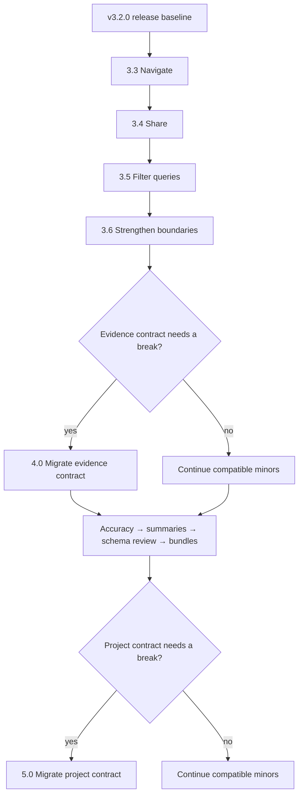

# SQL Cartographer roadmap — v3.3.0 through v5.0.0

**Status:** Proposed delivery sequence; no future release is implemented or promised.
**Planning baseline:** 12 October 2026; updated for v3.2.0 on 13 October 2026.
**Next release:** [v3.3.0 implementation plan](../../tasks/v3.3.0-plan.md) and
[task checklist](../../tasks/v3.3.0-todo.md).

## Direction

Make unfamiliar SQL pleasant to investigate, explain, and share. Each release
should complete one useful journey and leave the code easier to change.
Beautiful diagrams should communicate evidence, relationships, and uncertainty
clearly enough to stand on their own.

| Project ambition | Observable release evidence |
| --- | --- |
| Pleasant to read | Useful initial scale, complete names available on demand, consistent legends, and recorded diagrams at desktop and 200% zoom |
| Pleasant to use | A short route to the main action, keyboard access, reversible changes, and recovery that preserves input |
| Pleasant to learn from | A small worked example explaining the feature and a reviewer who can follow it without the author |
| Pleasant to maintain | Typed boundaries, focused fixtures, generated runtime kept current, and a documented path through changed code |
| Wonderful to share | Clear composition and typography, export parity, visible limitations, and intentional handling of embedded source |

These are review criteria, not claims that a usability study has already passed.

## Starting point and constraints

- v3.2.0 is the release baseline. It delivers reading-scale diagrams,
  evidence inspectors, diagnostic lists, four lessons, and extracted views.
  Actual 200% browser zoom and keyboard interactions were reviewed; the
  [release checklist](../../tasks/todo.md) records qualification and the limits
  of the baseline images and first-time-user evidence. Preserve these limits.
- Flow, estate, lineage, report, ERD, layout, and query-building capabilities
  already exist. Search and neighbourhood focus exist on the ERD page; v3.2.0
  adds flow selection and immediate-neighbour focus. Extend these workflows.
- Analysis is heuristic and conservative across T-SQL, DB2 SQL PL,
  PL/pgSQL, and SQLite. The realistic corpus currently contains one fixture
  per dialect. Passing fixture metrics do not establish general SQL correctness.
- The query builder has joins, grouping, aggregates, sorting, row limits,
  and explicit saved-query files. It has no structured `WHERE` controls,
  `HAVING`, window functions, or `COUNT(*)`.
- The runtime uses ordered classic scripts and vendored Mermaid. The strict
  TypeScript pilot covers selected modules; several controllers and analysis
  modules remain large. Prefer extracted boundaries over a framework rewrite.
- Workspace schema 2, query-file versions 1/2, and ERD layouts already carry
  compatibility obligations. New features must plan migration and drift recovery.
- Runtime analysis remains local, with explicit save/import/export. Database
  connections, SQL execution, telemetry, accounts, and cloud collaboration are
  outside this sequence.

Evidence: [architecture](../ARCHITECTURE.md), [accuracy](../ACCURACY.md),
[query-builder limits](../QUERY_BUILDER.md), [release metrics](../metrics-v3.2.0.json),
[strict pilot](../../tsconfig.strict.json), and
[existing compatibility contract](../V2_ACCURACY_CONTRACT.md).

## Capacity and planning horizon

Assume one maintainer familiar with this code, existing tooling, and access to
two reviewers at release checkpoints. A person-week means roughly 40 focused
hours. Estimates include implementation, fixtures, documentation, and normal
qualification; allow another 25% across the sequence for bugs, review rework,
and interruptions. They exclude finishing v3.2.0.

Only v3.3.0 is ready for task-level planning. Re-estimate v3.4.0 after the first
review checkpoint. Everything from v3.5.0 onward is a bounded direction with a
discovery gate. Do not book dates for the whole roadmap.

If every proposed release, including both conditional majors, proves useful,
the envelope is **33–51 person-weeks, or about 41–64 with contingency**.
That is roughly 10–15 months at full-time capacity, or 3–5 years at 10 hours
per week. Additional maintainers can shorten independent work, but semantic
review and migration decisions still need an owner. Cut deferred features
before cutting qualification.

## Release sequence

| Version | Main user outcome | Bounded scope | Estimate | Dependency / decision |
| --- | --- | --- | --- | --- |
| v3.3.0 | Find the relevant step in an unfamiliar diagram | Flow Find, diagnostic filters, resilient keyboard/source navigation | 2–3 weeks | Finish v3.2.0; review the navigation baseline |
| v3.4.0 | Share a diagram that explains itself | Presentation presets, explicit full/focused export, evidence manifest | 3–4 weeks | v3.3.0 navigation and export-scope review |
| v3.5.0 | Build a useful filtered query safely | Small structured `WHERE` editor, NULL handling, saved-query migration | 3–5 weeks | Predicate/row-policy design review |
| v3.6.0 | Keep growing the tool without growing controller risk | Typed analysis/presentation boundary, two targeted extractions, current performance baseline | 3–5 weeks | Characterisation fixtures; measure before restructuring |
| v4.0.0* | Understand what the analyser has evidence for | Replace the legacy confidence contract only if a better evidence model is validated | 4–6 weeks | Major-contract decision and migration review |
| v4.1.0 | Resolve one important SQL gap honestly | One construct family in one dialect, with broader realistic/adversarial evidence | 3–5 weeks | Diagnostic/corpus findings, not a coverage-percentage target |
| v4.2.0 | Explain and filter grouped results | `COUNT(*)`, bounded aggregate `HAVING`, multiplication/NULL explanations | 3–5 weeks | v3.5.0 predicate model; aggregate design review |
| v4.3.0 | Review a declared schema change | Deterministic before/after DDL comparison, readable change map and export | 4–6 weeks | Identity/rename policy and schema fixtures |
| v4.4.0 | Hand another developer a reproducible local review | Explicit review bundle containing selected inputs, settings, layouts, and notes | 4–6 weeks | Export manifest and file-format/privacy design review |
| v5.0.0* | Consolidate a durable review-project contract | A justified replacement of incompatible legacy contracts, migration tooling, and qualification | 4–6 weeks | Evidence from v4.x use; approved breaking-change proposal |

\* Major-version labels are decision gates. An internal refactor, new export,
or additional file format alone does not justify a major. If the work stays
compatible, release it as the next minor and postpone the major. If v4.0.0 is
not justified, the following v4.x candidates continue as v3.7.0 onward; if
v5.0.0 is not justified, its compatible work continues as v4.5.0 onward.
Do not manufacture breaking changes to reach the version number.
Patch releases handle narrow regressions and urgent correctness fixes between
these milestones.

## v3.3.0 — Find and follow

**Journey:** Open a realistic procedure or estate, find a named step, inspect
its immediate neighbours, and open the correct source without losing context.

- Add a labelled Flow **Find** control matching node labels and complete object
  names. Use deterministic result order, previous/next actions, result count,
  keyboard selection, and an explicit clear action. Keep ERD Find intact.
- Filter findings by severity and code. Display both total findings and the
  visible count; document-scoped findings never acquire invented source links.
- Keep search/focus transient. Refresh, object switching, Escape, and resize
  must leave a valid selection or explain why it was cleared. Search does not
  change graph facts, analysis counts, or exported content.

**Acceptance:** A keyboard user can find a node and follow the right owning
input; duplicate labels and grouped spans stay distinguishable; a 250-node
fixture is navigable at reading scale without switching to tiny overview text.
Record behaviour at 1366×768, 1920×1080, 768×1024, and actual 200% browser zoom.
Two non-author reviewers attempt find → inspect → source → return. Fix blocking
failures and record smaller findings; do not report a general usability score
from this small review.

**Boundary:** No fuzzy ranking, command palette, editor replacement, persistent
bookmarks, arbitrary reachability paths, or new parser rules. Limit each task
to about five authored files and keep integration separate from pure helpers.

## v3.4.0 — Share clear evidence

**Journey:** Export a diagram for a code review and let its reader understand
scope, relationship kinds, and unresolved evidence without opening the app.

- Add two presentation presets: reading and review. Agree typography, wrapping,
  spacing, legend placement, and light/dark output on five existing fixtures.
  Apply shared visual tokens incrementally; retain established semantic styles.
- Offer explicit full-graph or focused-neighbourhood export. Default to the
  full graph. A focused export identifies its scope and excluded-node count;
  it is never presented as the complete analysis. Temporary search dimming is
  removed from exports.
- Download a small companion evidence manifest: app/contract versions, input
  fingerprints, graph scope, provenance, diagnostic summary, and analysis
  limitations. Source text is a separately labelled opt-in; diagram labels can
  themselves contain sensitive names. Document the fingerprint's purpose and
  limitations rather than treating it as anonymisation or a signature.

**Acceptance:** Full and focused exports preserve the facts in their declared
scope across supported SVG, Mermaid, and draw.io paths; hostile labels remain
escaped; reviewers can identify the scope and unresolved evidence. Test print
and dark backgrounds on bounded examples. Document ERD export differences.

**Boundary:** No new renderer, automatic diagram paging, PNG/PDF pipeline,
live share links, or promise that every 500-node graph fits on one readable page.

## v3.5.0 — Structured query filters

**Journey:** Select declared columns, add a small filter, understand its effect
on rows, and export/restore that exact intention.

- Support a flat `AND` list of column comparisons (`=`, `<>`, `<`, `<=`, `>`,
  `>=`) and `IS NULL` / `IS NOT NULL`, using declared columns in the current
  join plan. Allow string and finite numeric literals with dialect-correct
  serialization. Do not guess a database's implicit type conversions.
- Explain that a `WHERE` predicate on the nullable side of a `LEFT JOIN` can
  remove the unmatched rows. Preserve the chosen predicate and join policy;
  do not silently move it into `ON` or alter the join.
- Version query files; migrate old files to an empty filter list. A missing
  predicate reference on restore must block SQL generation until the user
  removes or repairs it explicitly. Dropping a filter could widen the query.
  Reject future versions without altering stored bytes.

**Acceptance:** Clause order, literal escaping, NULL semantics, aliases,
grouping interaction, and round-trip behaviour have fixtures across all four
emission dialects. Invalid predicates visibly block copying/downloading SQL.
Update the saved-query decision record if this recovery policy changes its
existing pruning contract.

**Boundary:** No nested `OR`, arbitrary expressions, date coercion, subqueries,
parameter execution, `HAVING`, or SQL-to-builder reverse import.

## v3.6.0 — Boundaries and measured responsiveness

**Journey:** A contributor can trace one feature through analysis, state, view,
and export, then change it without editing an entire controller.

- Define a typed, DOM-free boundary around existing analysis results. Move
  the two highest-change controller responsibilities behind explicit callbacks
  or pure helpers, chosen from recent diffs. Characterise behaviour first;
  retain global-script and local-file startup compatibility.
- Extend strict checking to those extracted modules. Enforce one-way
  dependencies and runtime allowlist/load-order parity. Update the architecture
  and contributor walkthrough in the same slices.
- Re-measure the documented 100/500 KB inputs, 100-object estate, 250/500-node
  diagrams, and 25-dataset report. Separate analysis, layout, rendering, and
  interaction costs. Identify the main bottleneck before proposing a worker.

**Acceptance:** Existing semantic/export outputs remain equivalent; both pages
load from the packaged local files; a non-author contributor follows the new
boundary from the documentation. Record a current machine/browser baseline and
agree budgets before optimising. Investigate sustained regressions above 15%
on repeated same-machine runs; timing remains outside ordinary correctness CI.

**Boundary:** No simultaneous ES-module/framework migration, full strictness
conversion, public SDK, or mandatory worker. A worker is a later scoped change
only if measurements justify its loading and fallback complexity.

## v4.0.0 — Conditional evidence-contract transition

**Problem to validate:** The legacy confidence headline combines dialect,
coverage, and region quality. Determine whether reviewers mistake it for proof
of dependency or lineage correctness despite the existing explanations.

Prototype capability-specific evidence summaries beside the current score:
control flow, dependencies, columns, and declared schema each retain explicit
resolved/approximate/opaque/unresolved states and source evidence. Do not
interpret these categories as statistically calibrated probabilities.

Ship a major only if the validated design requires changing/removing the
documented confidence formula, field meanings, or diagnostic semantics.
An additive display can ship as a minor. Before implementation, record a
proposed ADR, affected consumers/files, old→new mappings, compatibility window,
and comparison fixtures. Include at least three realistic, anonymised or
constructed scenarios per supported dialect; keep forbidden-edge assertions.

**Acceptance:** Reviewers distinguish token coverage from semantic evidence;
old exported confidence values remain labelled with their formula version;
the transition is documented and deterministically tested. Keep graph edge
meanings and uncertainty rules unless a separate justified change is approved.

**Boundary:** No assertion of compiler correctness, calibrated probability,
AI-generated facts, or removal of traceability to simplify the model.

## v4.1.0 — One demonstrated analysis gap

Select one construct family in one existing dialect from anonymised reports
and unresolved regions in the expanded corpus. Candidates include scope
binding or a procedural boundary only where a failing fixture demonstrates
an actual gap; existing `MERGE`, CTE, `APPLY`, and lineage features are not
newly promised here.

Ship required/forbidden semantic assertions, malformed and ambiguous variants,
source-span checks, and export parity. Add one worked lesson showing the new
boundary of support. If the family needs more than five weeks, split it into
two minors rather than claiming broad dialect completeness.

**Acceptance:** The chosen examples resolve for the right reason; ambiguous
and dynamic variants remain explicit; no assertion rates regress. Publish a
support-matrix delta naming exactly which dialect and constructs changed.

**Boundary:** No new dialect, general SQL grammar rewrite, or inferred dynamic
SQL dependencies. Apply the same selection process to later accuracy minors.

## v4.2.0 — Grouped results people can explain

Add an explicit row-count expression (`COUNT(*)`) and a flat `AND` list of
`HAVING` comparisons against aggregates already in the query. Reuse the
structured predicate validation and blocked-restore policy from v3.5.0.
Teach the difference between row count, non-NULL count, distinct count, and
join multiplication with a small declared-schema lesson.

**Acceptance:** Stable aliases, aggregate sorting, `WHERE`→`GROUP BY`→`HAVING`
ordering, all-aggregate queries, and saved-query migrations pass dialect
fixtures. Warnings explain multiplication; generated SQL never silently
changes an aggregate or pre-aggregates a join.

**Boundary:** No arbitrary expressions, window functions, grouping sets,
automatic aggregation repair, or general visual SQL editor.

## v4.3.0 — Declared schema change review

Compare two DDL inputs within one chosen dialect. Show added/removed/changed
tables, columns, keys, and foreign keys in a readable list and diagram; link
each change to the relevant before/after source. Use declared identity and
normalised structure, not fuzzy name matching.

**Acceptance:** Ordering and formatting changes create no semantic delta;
constraint/type changes remain visible; unresolved regions are identified as
uncompared. Renames default to removal/addition unless the user explicitly
supplies a mapping, which is labelled. Export reproduces the compared scope.

**Boundary:** No migration SQL, live catalogues, cross-dialect equivalence,
automatic rename guesses, data-loss predictions, or runtime dependency impact
claims. Any future impact map needs its own evidence contract.

## v4.4.0 — Reproducible local review bundles

Design a versioned JSON bundle for explicitly selected SQL, catalogue/report
inputs, DDL, options, named query/layout files, and reviewer notes. Preview
included content before export. Keep notes separate from analysis facts and
regenerate derived results on import with the producing app/contract versions
recorded. Input or contract drift invalidates cached results visibly.

**Acceptance:** Two fresh local browser sessions reproduce the selected review;
malformed, oversized, and future-version bundles fail without replacing current
work; unsaved input replacement is cancellable. Existing workspace/query/layout
imports remain supported or have a tested, explicit conversion path.

**Boundary:** No accounts, syncing, real-time collaboration, plugin execution,
automatic saving, encryption promise, or format that embeds untrusted scripts.
Choose import limits and field schemas in an ADR before implementation.

## v5.0.0 — Conditional project-contract consolidation

After v4.x usage, determine whether the old workspace/query/layout contracts
can still represent intended review state faithfully and be maintained safely.
The preferred outcome is compatible readers and optional bundles. A major is
justified only by a necessary incompatible project/analysis contract change
with a specific user benefit, not by finishing this roadmap.

If justified, first publish deprecation notices during a minor release and a
local converter that preserves original files. Inventory accepted formats,
supported versions, storage keys, semantic changes, and recoverable failures.
Qualify migrations with round trips and deliberately incompatible cases;
provide a previous-release escape path. Set support/deprecation duration based
on actual users and release cadence before removing anything.

**Acceptance:** Every promised older input has a tested conversion or a clear
rejection with original bytes intact; current review bundles reproduce evidence
and presentation; local ZIP startup, documentation, and contributor onboarding
meet the same release bar. If compatibility remains intact, ship a minor.

**Boundary:** No forced cloud service, database execution, multi-engine rewrite,
or discard of old user data to simplify maintenance.

## Shared implementation and release gates

1. **Before coding:** Review one journey, maximum two or three substantive
   outcomes, sketches/examples, file/contract impacts, and explicit exclusions.
   Turn the next release into small tasks with criteria, dependencies, and checks.
   Use proposed ADRs for contract decisions; do not mark future decisions accepted.
2. **Correctness:** Behaviour changes carry required and forbidden fixtures.
   Preserve provenance, conservative uncertainty, deterministic output,
   presentation/analysis separation, escaping, and explicit persistence.
   Fix false assertions promptly; never relax a fixture to reach a metric target.
3. **Readability and accessibility:** Capture the same five representative
   diagrams in light/dark themes at two desktop sizes and the stacked size.
   Perform actual 200% browser zoom, keyboard/focus, long-name, and recovery
   walkthroughs. Record two non-author reviews when a workflow changes;
   disclose any missing review and resolve release-blocking findings.
4. **Learning and maintenance:** Add one concise example per new journey;
   update the guide, glossary where needed, module boundaries, and changelog.
   Include strict checks for new extracted modules; keep generated `dist/`
   current and authored slices small. Budget roughly 20% of each feature
   release for this work rather than postponing it to a major.
5. **Qualification and publishing:** Follow [RELEASES.md](../RELEASES.md).
   Build/typecheck/strict pilot, lint, full browser suites, Firefox CI, local-file
   startup, metric invariants, packaging smoke, and checksum verification are
   required. Use `npm run benchmark` when analysis/layout changes; qualify new
   formats with migration/future-version/hostile-input cases. Tag and publish
   only the complete reviewed release tree after the PR merges.

These gates are planned checks for implementation. This roadmap edit does not
change runtime code or re-qualify v3.2.0.

## Replanning rules and risks

| Risk / unknown | Decision or mitigation |
| --- | --- |
| Reviewers unavailable | Keep the release a candidate, record automated evidence, and arrange review before claiming usability validation |
| Scope grows beyond estimate | Finish the smallest coherent journey; move extra outcomes to another minor |
| Fixture corpus is too narrow | Add realistic/adversarial cases before broadening support claims; never use confidential input unchanged |
| Performance problem is rendering, not parsing | Measure stages separately; evaluate a worker only for costs it can actually remove |
| Query drift silently broadens results | Block on missing predicates and require explicit repair/removal |
| Contract break has no measurable benefit | Keep compatibility and continue minors; postpone the major |
| Bundle/export leaks intended-private content | Explicit inclusion preview and opt-in source; explain sensitive labels and metadata |
| Controller extraction becomes a rewrite | Move one responsibility per slice and retain characterised outputs and loading contracts |

After every release, record completion/failures, actual effort, user reports,
and maintenance costs. Re-rank the next two releases; only then write the next
task checklist. Reconsider v4.3/v4.4 if users need additional accuracy work more
than schema comparison or bundles. Unselected opportunities include workers,
additional dialects, CLI/SDK reuse, deeper reachability, window queries, and
automatic paging; each needs independent evidence and scope.
