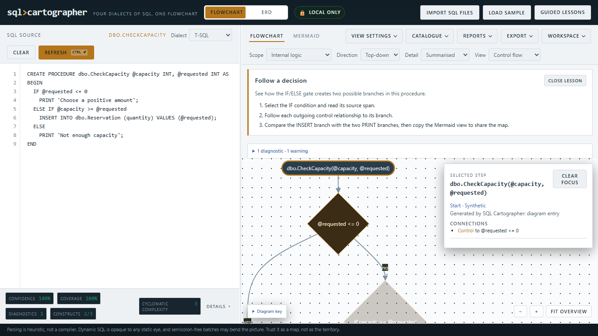
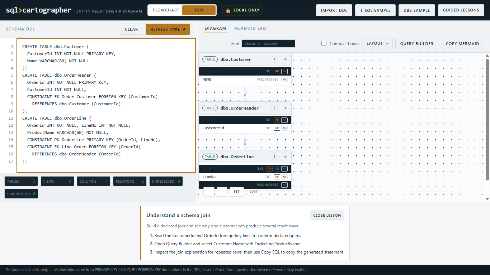

# v3.2.0 — Clear diagrams and guided exploration

- **Release date:** 13 October 2026.
- **Status:** Browser review and local release qualification passed.
- **Base:** v3.1.0.
- **Scope:** More readable diagrams, inspectable evidence, actionable diagnostics, four curated lessons, and smaller presentation modules.

## What changed

- Flow diagrams keep labels readable on arrival. **Fit overview** remains an
  explicit action; selecting a step highlights and frames its immediate
  modelled neighbours. Clearing focus restores the previous viewport.
- A flow inspector explains node class, provenance, available catalogue
  resolution, source evidence, and incoming/outgoing relationship kinds.
  Source and object navigation happen through explicit buttons.
- Flow and ERD findings share a text-safe diagnostic view with severity, stable
  code, scope, message, source location, and next-step hints for common codes.
- Three flow/query lessons cover a decision, temporary-table data flow, and a
  CTE pipeline. A three-table schema lesson connects declared foreign keys to
  a query plan and its row-repetition explanation. Guided and representative
  samples ask before replacing non-empty input.
- Flow diagram presentation and ERD card/inspector builders now have typed UI
  boundaries. The contributor guide follows a lesson from sample SQL through
  analysis and the graph to exported output.
- Downloaded SVGs omit temporary focus decoration while the on-screen view
  remains selected. Existing workspace, query, and layout formats are retained.
- Source navigation resolves the owning object, report XML, or catalogue input.
  Stale actions preserve edited input, and clearing SQL clears old diagnostics.
- At 200% browser zoom, stacked controls wrap and scroll with the page; keyboard
  focus keeps the flow inspector and zoom controls inside the canvas.

## Experience review

The maintainer review and its stated limits are recorded in
[the v3.2.0 review sheet](../plans/v3.2.0-review.md). It includes the actual Edge
200% zoom walkthrough, keyboard interactions, light/dark captures, and fixes.
No timed first-time-user study or independent human walkthrough is claimed.
Representative screenshots:

## Verification

| Gate | Result |
| --- | --- |
| `npm run lint` | Pass — 69 files |
| `npm run typecheck` | Pass |
| `npx tsc --project tsconfig.strict.json` | Pass |
| `npm run build` | Pass |
| `npm test` | Pass — golden 222/222; fuzz 400 cases; UI 67/67; ERD UI 74/74; security 7/7 |
| `npm run test:file` | Pass — local-file runtime loaded |
| `npm run metrics:write` / `npm run metrics` | Pass — v3.2.0 snapshot generated and current |
| `npm run package:smoke` | Pass — archive structure and local-file smoke |
| `npm run benchmark` | Pass — 0 overlaps/crossings across recorded graph fixtures |
| Actual Edge 200% zoom walkthrough | Pass — flow/report/schema evidence, keyboard source/query actions, both themes, no page overflow |
| Separate AI code review | Approved — source ownership, stale input, responsive fixes, and release-doc gate |

The local runtime archive is `.release/sql-cartographer-v3.2.0.zip`; its SHA-256
is `3ae3296373e9f2c2772a5f69da4aec2d422a77b94629af93d6c77753b8d68a91`.
The 4,067,501-byte archive and `.release/SHA256SUMS.txt` accompany the
[GitHub release](https://github.com/ikelaiah/sql-cartographer/releases/tag/v3.2.0).

The runtime archive and SHA-256 checksum are built by `npm run package:runtime`.
The package smoke verifies that archive before publication. The visual review
limits are listed in the linked review sheet.
