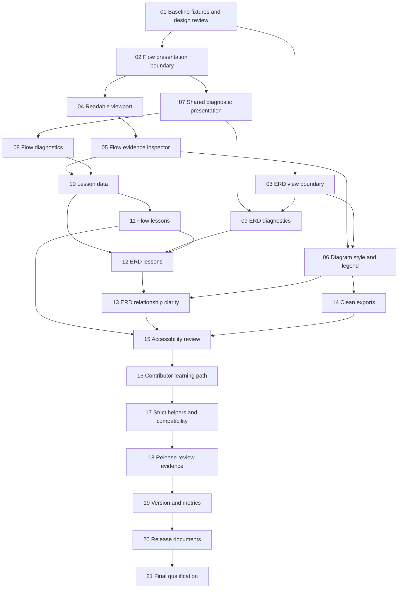

# Implementation plan: SQL Cartographer v3.2.0

**Status:** Implementation, actual 200% browser review, and local release
qualification completed on 13 October 2026. See the release checklist.

**Theme:** Clear diagrams and guided exploration.

**Specification:** [v3.2.0 proposal](../docs/plans/v3.2.0.md).

**Execution checklist:** [todo.md](todo.md).

The previous v2.0.0 qualification documents are preserved in the archive:
[plan](../docs/archive/v2.0.0-qualification-plan.md) and
[tasks](../docs/archive/v2.0.0-qualification-tasks.md).

## Approach

Deliver complete reading journeys in small slices: readable diagram → select
a step → inspect evidence → resolve uncertainty → share output. Add learning
examples once those interactions exist. Extract presentation code immediately
before the feature that needs it, keeping behaviour-preserving moves separate
from behaviour changes.

The feature scope is R1–R5 in the specification. Every required outcome must
land to call this release complete. Additional sample families, minimaps,
advanced layout controls, new parser constructs, and renderer replacement
are later candidates.

## Implemented architecture

| Concern | Proposed home and boundary |
| --- | --- |
| Flow SVG presentation, selection, viewport | `src/ui/flow-diagram.ts`; consumes graph/SVG and page callbacks, does not analyse SQL |
| ERD card and inspector DOM | `src/ui/erd-view.ts`; builds views from schema/relationship data, does not own query state |
| Diagnostic summary, list, hints | `src/ui/diagnostics.ts`; consumes `Diagnostic[]` and explicit source-navigation callbacks |
| Curated lessons | Typed data in `src/samples.ts`; controllers choose samples and protect replacement of user input |
| Evidence explanations | Pure helpers alongside relevant views; consume recorded provenance, spans, resolution, and edge kinds |
| Page state and navigation | Existing controllers; invoke analysis, own selected object/input, and handle explicit actions |

These boundaries are implemented. The analysis and ERD layout
implementations remain separate as described in
[ARCHITECTURE.md](../docs/ARCHITECTURE.md).

Presentation state is transient. Neighbour highlighting changes decoration
without changing graph data. Source navigation resolves the owning input before
applying offsets; grouped nodes expose every recorded span. SVG export uses a
clean clone or undecorated rendering so temporary dimming cannot become permanent
exported styling.

No persistence schema changes are planned. Register new scripts in HTML loading
order and `scripts/package-runtime.mjs` together. Keep Mermaid's strict security
mode. New pure helpers join the strict pilot through typed interfaces rather
than extending a page controller with more implicit state.

## Order and checkpoints

| Checkpoint | Tasks | Review evidence |
| --- | --- | --- |
| A. Direction agreed | 01 | Five baseline inputs, before images, inspector layout, accepted bounded scope |
| B. Reading works | 02–06 | Readable chart, evidence inspector, reversible focus, consistent legend, unchanged semantics |
| C. Problems are understandable | 07–09 | Both pages distinguish diagnostic severities and navigate to valid evidence |
| D. Learning journey works | 10–13 | Four short lessons, protected sample replacement, clear declared-join explanations |
| E. Experience is coherent | 14–18 | Clean exports, keyboard walkthrough, theme/narrow-layout review, compatibility evidence |
| F. Release qualified | 19–21 | Matching versions, new metrics snapshot, full gates, canonical release evidence |

Diagnostic and lesson data work can proceed independently after their contracts
are defined. Shared CSS, `samples.ts`, HTML order, and packaging changes need
coordination. Extraction precedes feature edits in that controller. Version
promotion follows evidence.

## Verification strategy

Use focused UI/ERD suites for selection, viewport changes, source actions,
diagnostic actions, and cancellation. Semantic/parity fixtures prove that
presentation preserves graph facts and export metadata. Retain hostile-label
and diagnostic security cases, plus v3.1.0 saved-file compatibility cases.
The strict pilot checks new pure helpers without rewriting all legacy globals.

Every user-visible slice updates its guide and gets real browser review.
Compare the agreed fixtures at both desktop sizes, both themes, 200% browser
zoom, and a stacked layout. Performance checks ensure selection and focus do
not invoke analysis; benchmarks compare the same input and machine.

Task file lists name primary authored files. Generated `dist/` output is
additional and rebuilt with source changes. If required tests, docs, or loading
order take a task beyond roughly five authored files or one focused session,
split it before implementation. Every intermediate commit remains usable and
packaged correctly.

## Risks and responses

| Risk | Response |
| --- | --- |
| Inspector or toolbar becomes crowded | Review layouts first; keep the default path short and explanations expandable |
| Reading scale places part of a graph outside the viewport | Explicit overview, pan, neighbourhood focus, and clear reset |
| Grouped/cross-object source navigation uses wrong offsets | Resolve input first; test grouped nodes and multi-file workspaces |
| Focus looks like a verified runtime path | Say neighbours, preserve edge meanings, avoid execution claims |
| SVG export preserves temporary dimming | Export an undecorated clone/render; compare before/after selection |
| Modules break local-file startup or runtime ZIP | Register loading order and packaging together; run smoke checks |
| Lessons become a tutorial platform | Four curated lessons and existing advanced samples only |
| Presentation changes semantics | Separate refactors and features; keep parity/golden checks |

## Completion and remaining decisions

Complete when R1–R5 pass their evidence checks and checkpoint F is green.
Optional polish cannot compensate for missing source correctness, accessible
navigation, or compatibility.

The maintainer review chose the inspector placement, reading-scale policy,
and four lessons during implementation. The review sheet records the
approximate before references, completed actual 200% browser walkthrough,
and the remaining human/timed usability evidence limits. Source navigation,
stale-input protection, and zoom layout findings were fixed and qualified.
The canonical release note records the archive and checksum.
