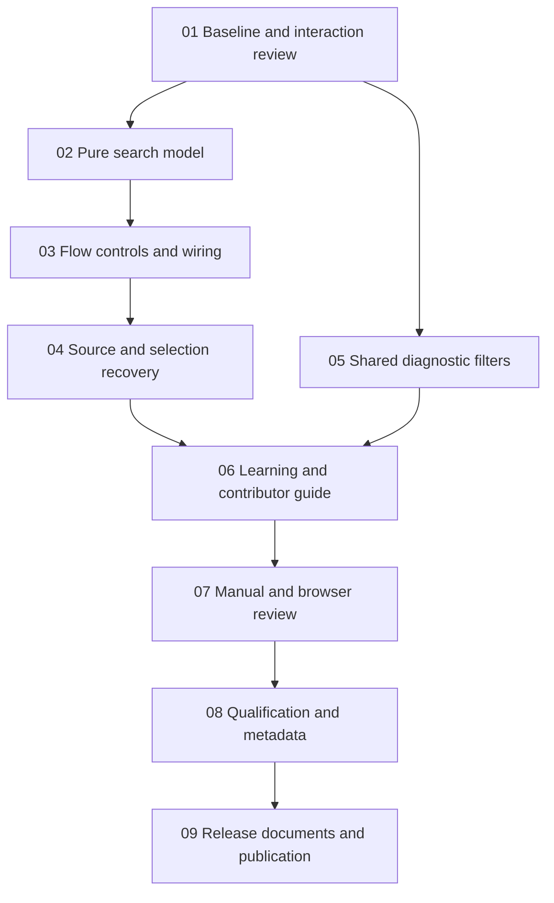

# Implementation plan: SQL Cartographer v3.3.0

**Status:** Proposed; implementation has not started.
**Theme:** Find and follow.
**Scope:** [Roadmap and release criteria](../docs/plans/v3.3.0-to-v5.0.0.md#v330--find-and-follow).
**Execution checklist:** [v3.3.0-todo.md](v3.3.0-todo.md).

The existing [plan.md](plan.md) and [todo.md](todo.md) remain the v3.2.0 delivery
record. Finish that candidate's outstanding release work before publishing
v3.3.0. This plan authorises no runtime work by itself.

## Proposed interaction

Use the existing flow toolbar for a labelled **Find** field, result count,
previous/next controls, and **Clear**. Match displayed labels and full recorded
object names case-insensitively; retain graph order. Duplicate labels show
identity and owning-source context. Search selects and frames an existing node
using the v3.2.0 inspector and neighbourhood focus.

Escape clears search/focus and returns focus predictably. Typing in SQL or
another form control must never trigger diagram shortcuts. Analysis refresh
clears a vanished selection and recomputes matches; switching input does not
reuse offsets from the previous owner. Keep search state in the controller
and presentation helpers, with no storage or semantic-graph mutation.

Extend the shared diagnostic view with severity and code filters. Its summary
continues to show total findings alongside visible findings. The controller
still resolves the correct source input before navigating. Both Flow and ERD
use the same filtering behaviour.

## Order

Checkpoint A follows tasks 01–02: review matching and interaction before wiring.
Checkpoint B follows tasks 03–05: review the complete keyboard/source journey.
Checkpoint C follows tasks 06–07: fix blocking usability findings before release.

## Size and verification

Estimate 2–3 person-weeks before the roadmap's contingency. Tasks fit focused
sessions and approximately five authored files; generated `dist/` is rebuilt
with source changes. Split source/selection recovery or diagnostic wiring if
characterisation reveals more owners than listed. One engineer can implement
the two helper areas independently after task 01; integration remains ordered.

Use the existing suites and scripts. Pure helper cases can join the golden
harness; interactions belong in `ui` / `erd-ui`. No new browser runner or runtime
dependency is planned. Planned commands and manual checks are in the checklist.

## Review questions to settle in task 01

- Should the Find toolbar expand inline or wrap at the stacked width? Choose
  from a real rendered sketch at 200% zoom.
- Which recorded object/source fields distinguish duplicate labels across
  each flow/estate graph class? Preserve complete names; avoid invented identity.
- Can filtering stay entirely within the shared diagnostic view? Keep source
  navigation callbacks explicit if page ownership requires controller wiring.
- Measure the 250-node search/selection baseline before agreeing an interaction
  budget. Timing is recorded evidence, not a flaky correctness assertion.

## Exclusions

No fuzzy search, command palette, parser changes, persistent bookmarks, editor
replacement, arbitrary path analysis, or changed export scope. v3.4.0 handles
explicit focused exports. Search highlighting must not leak into today's exports.
